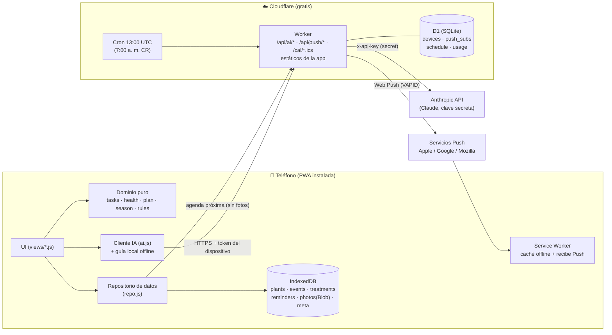
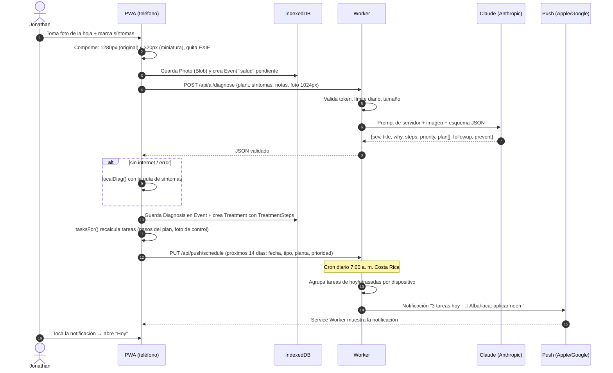

# Mi Jardín — Revisión de arquitectura y plan para usarla fuera de Claude

> Revisión hecha con el enfoque del agente *architect-reviewer* (patrones, escalabilidad, seguridad, deuda técnica, ruta de evolución).
> Archivo revisado: `/home/claude/mi-jardin.html` (1 003 líneas, ~97 KB sin datos; HTML + CSS + JS sin build).
> Fecha: 15-nov-2026.

---

## 0. Decisiones tomadas por Jonathan (16 nov 2026)

Estas decisiones **reemplazan** las recomendaciones de la sección 10 donde no coincidan.

| # | Decisión | Elegido | Consecuencia en el diseño |
|---|---|---|---|
| 1 | Sincronizar / compartir | **Sí: varios teléfonos y familia** | Supabase (Auth por enlace mágico al correo + Postgres + Storage para fotos) entra al plan principal, ya no es "Fase 4 opcional". Modelo "jardín compartido": un `garden` con miembros (dueño / colaborador). IndexedDB queda como caché offline. |
| 2 | Hospedaje | **GitHub Pages + Cloudflare** | La app (PWA estática) se publica desde el repo en GitHub Pages. El Cloudflare Worker queda solo para: proxy de IA, push diario y cron. |
| 3 | IA | **Proveedor económico o gratis (no Anthropic)** | El Worker se vuelve **multiproveedor** (formato compatible con OpenAI). Ver 6.6. |
| 4 | Dirección | Sin decidir | Por defecto `usuario.github.io/mi-jardin`. |

### 6.6 Proveedores de IA económicos (resumen para la decisión 3)

| Proveedor | ¿Ve fotos? | Costo | Notas |
|---|---|---|---|
| **Google Gemini Flash (nivel gratis)** | Sí | **Gratis** dentro de los límites | Límites por proyecto, se ven en AI Studio y Google los ha recortado (p. ej. ~20 solicitudes/día en Flash según terceros). En el nivel gratis Google puede usar las solicitudes para mejorar sus productos (fotos de plantas: riesgo bajo). |
| **DeepSeek Flash** | Sí (desde sept. 2026, `deepseek-flash`) | ~USD 0,22 por millón de tokens de entrada; cada imagen cuesta máx. 384 tokens → fracciones de centavo por foto | Muy barato; la visión es reciente (salió como experimental en agosto 2026), conviene probar la calidad de diagnóstico. |
| xAI Grok | Sí (Grok 4 Fast) | ~USD 0,20 / millón entrada; **sin nivel gratis** | Opción de respaldo. |

**Recomendación:** Gemini Flash gratis como principal y **DeepSeek Flash como respaldo automático** cuando Gemini responda 429 (cuota agotada). Costo esperado: USD 0–1 al mes. El Worker guarda ambas claves como *secrets*, valida el JSON de respuesta igual que hoy y mantiene la guía local de síntomas para modo sin conexión. Los prompts y esquemas JSON actuales se reutilizan sin cambios; solo cambia el adaptador del proveedor.

### Plan de fases ajustado

1. **Fase 1 — Fuera de Claude (1 sesión):** repo en GitHub, PWA en GitHub Pages, IndexedDB, importar el HTML actual con los datos, Worker con Gemini + DeepSeek. Criterio: la app abre desde el ícono del iPhone sin Claude y diagnostica una foto.
2. **Fase 2 — Familia:** Supabase (cuentas por correo, jardín compartido, fotos en Storage, sincronización por registro con "última edición gana" por campo). Criterio: dos teléfonos ven el mismo riego marcado en < 10 s.
3. **Fase 3 — Recordatorios reales:** Web Push diario 7 a. m. a cada miembro desde el cron del Worker + calendario .ics de respaldo.
4. **Fase 4 — Calidad:** separar dominio/UI, pruebas, correcciones del anexo.

---

## 1. Resumen ejecutivo

**Recomendación:** convertir Mi Jardín en una **app web instalable (PWA)** alojada gratis en **Cloudflare**, que guarda los datos y las fotos **en el propio teléfono** (IndexedDB) y usa un **pequeño servidor intermediario (Cloudflare Worker)** para hablar con Claude con tu propia clave de Anthropic escondida, y para mandar **notificaciones reales** (un resumen diario a las 7 a. m.).

- Funciona en iPhone y Android, se instala desde el navegador ("Agregar a pantalla de inicio"), sin tiendas de apps.
- Costo estimado: **USD 1–4 al mes** (casi todo es el consumo de la IA; el hospedaje es gratis).
- Se hace por fases: la **Fase 1 (una sesión de Claude Code)** deja la app actual funcionando fuera de Claude casi sin tocar su lógica; las siguientes la ordenan, agregan recordatorios y, si un día lo quieres, sincronización con la familia (Supabase).
- Lo único que debes decidir hoy está en la sección 10 (4 decisiones, con mi recomendación).

---

## 2. Revisión de la arquitectura actual

### 2.1 Cómo funciona hoy (en una frase)

Todo vive en un solo archivo: el estado es un objeto global `S = {v, plants, log}` (L157, L165–172). Cada cambio llama a `save()` (L295), que guarda en `localStorage` y, 4,5 s después, **reconstruye el HTML completo de la app con los datos dentro** (`buildDoc()`, L304–311) y lo publica como nueva versión del artifact (`publish()`, L312). La IA se usa vía `SAMPLE.json(prompt, {images, modelTier})` (L611, L736, L756, L797, L852, L873, L908).

### 2.2 Fortalezas (conservar)

| Fortaleza | Dónde | Por qué importa |
|---|---|---|
| **Las tareas se calculan, no se guardan.** La fecha del próximo riego/abono/medición se deriva del último registro del historial. | `tasksFor()` L232–258, `prioOf()` L259, `allTasks()` L265 | No hay tareas "huérfanas" ni desincronizadas. Esta función es el corazón del dominio y se puede reutilizar tal cual en el servidor para las notificaciones. |
| **Modo sin conexión de diagnóstico** con guía local de síntomas. | `SYMPTOMS` L190, `RULES` L199, `localDiag()` L883, `localPlan()` L829 | Ya existe un *fallback* cuando no hay IA. Se mantiene. |
| **Validación de las respuestas de la IA** (recorte de largos, `clampN`, listas blancas de emojis/categorías). | `clampN` L743, `identify()` L759–765, `startPlan()` L814–828 | Buena práctica: nunca confiar ciegamente en el JSON del modelo. |
| **Escape de texto** al pintar HTML. | `esc()` L217, usado ampliamente | Evita la mayoría de inyecciones de HTML. |
| **Fotos recomprimidas en el teléfono** (canvas → JPEG 1024 px para la IA, 320 px para guardar). | `makeImages()` L696–705 | Ahorra datos y, de paso, **elimina el GPS (EXIF)** de las fotos. |
| **Diseño móvil cuidado** (safe-area, hoja inferior, botones grandes, deshacer). | CSS L10–152, `showToast()` L322 | La experiencia ya es buena; la migración no debe cambiarla. |
| **Esquemas de respuesta de IA explícitos y reutilizables.** | `CARE_SCHEMA` L751, `PLAN_SCHEMA` L813, prompts L610, L735, L755, L796, L905 | Se convierten directamente en contratos del servidor (sección 6). |

### 2.3 Problemas y deuda técnica (priorizados)

**Críticos (riesgo de perder datos o de que la app no abra)**

1. **Persistencia reescribiendo el HTML entero** (`buildDoc()` L304–311, `publish()` L312–318). Cada riego anotado publica ~300 KB (y creciendo) con CSS+JS+datos. Consecuencias: (a) si cierras la app antes de 4,5 s (`setTimeout(publish,4500)`, L301) el cambio no llega a la nube; (b) cada cambio crea una versión nueva del artifact; (c) si falla el publish, el error se traga en silencio (L314–317); (d) código y datos quedan acoplados: actualizar la app = tocar tus datos.
2. **Fotos en base64 dentro del JSON** (`thumb` en plantas y en registros: L692, L700, L726–728, L954, L963). Además **la misma foto se guarda dos veces** (`p.thumb=thumb` y `r.thumb=thumb`, L726–728). Base64 pesa ~33 % más que el binario.
3. **`localStorage` tiene ~5 MB y el error de "lleno" se ignora**: `try{localStorage.setItem(...)}catch(e){}` (L297). Con ~15 KB por miniatura, a partir de unas **250–300 fotos** el respaldo local deja de guardarse **sin avisarte**. Fuera de Claude (sin el publish) eso sería pérdida de datos silenciosa.
4. **Resolución de conflictos por contador** (`readState()`, L168): gana entero el estado con `v` mayor (HTML embebido vs. localStorage). Si usas dos teléfonos, uno pisa al otro completo.
5. **Regex con *lookbehind* `(?<=\.)`** en `planFromSteps()` (L839). Safari anterior a iOS 16.4 no lo soporta y, como es un literal, **el script entero falla al cargar (pantalla en blanco)**. Fácil de corregir; obligatorio antes de publicar para "cualquier teléfono".
6. **Dependencia dura del entorno de Claude**: `window.claude.use("artifact")` y `("sample")` (L993–999). Fuera de Claude, `SAMPLE` queda `null` y se apagan identificación, fichas, planes, guías y comparación (L595, L608, L632, L730, L754, L870, L895).

**Altos (mantenibilidad y calidad)**

7. **Todo en un archivo, lógica de dominio mezclada con UI.** Ejemplo: `startPlan()` (dominio) se llama desde `localDiag()` (L885), que además genera texto de UI; `analyze()` (L890–921) arma el prompt, llama a la IA, decide el plan y pinta. Para quien mantiene con Claude Code, archivos de 1 000 líneas aumentan la probabilidad de que un cambio rompa otra parte.
8. **Render completo con `innerHTML`** en cada acción (`render()` L350–367): se reconstruye toda la pantalla, se vuelven a enganchar listeners (L365–366), se pierde el foco/scroll, y se necesitan parches para no perder lo escrito (`keepNote()` L882, `ui.noteText` L741). Aceptable con 4 plantas; molesto con 30.
9. **Un solo despachador gigante de eventos** (`if/else` de ~50 ramas, L932–982) con lógica de negocio dentro (p. ej. `fsave` L959–966, `healed` L949).
10. **El historial de tratamientos se pierde**: la planta tiene un único `p.treatment` (L820, L827); al empezar uno nuevo, el anterior terminado se sobrescribe. Para "evolución" es información valiosa.
11. **Comparación de fotos con baja resolución**: para comparar "antes vs. ahora" se envía la miniatura de 320 px de la foto anterior (`dataUrlBlob(prev.thumb)`, L733, L795) porque no se guarda la original. Esto limita la calidad del diagnóstico de evolución.
12. **Sin pruebas automáticas.** Funciones puras como `tasksFor`, `prioOf`, `readingAlert` (L266), `startPlan`, `seasonTips` (L382) son ideales para tests y hoy no tienen ninguno.

**Medios / menores**

13. Íconos que vienen de la IA se insertan **sin escapar** (`st.icon` L861, `t.icon` L379, L642; recortados a 4 caracteres en L749, L823). Riesgo bajo, pero conviene `esc()` o lista blanca de emojis.
14. IDs con `Math.random().toString(36).slice(2,9)` (L226): suficientes en un teléfono; para sincronizar entre dispositivos usar `crypto.randomUUID()`.
15. Fuentes de Google cargadas desde internet (L7–8): no funcionan sin conexión y filtran visitas a Google. Autoalojarlas.
16. Bug menor en `newKid()` L619: `normName(p.name)===normName(p.name)` siempre es verdadero (condición sin efecto).
17. Diagnósticos de Salud sin planta elegida se guardan con `plantId:null` (L924); el modelo nuevo debe aceptarlo.
18. Los prompts viven en el cliente: si se expusiera un proxy "genérico", cualquiera podría usarlo como Claude gratis con tu clave (ver sección 6).

### 2.4 Evaluación contra el checklist del revisor

| Criterio | Estado actual | Comentario |
|---|---|---|
| Patrones de diseño adecuados | 🟡 | Monolito de un archivo, apropiado para prototipo; falta separar dominio / datos / UI / IA. |
| Escalabilidad | 🔴 | El tamaño crece con cada foto y se reescribe completo en cada cambio. |
| Elección tecnológica justificada | 🟢 | Vanilla JS sin build es correcto para este tamaño y para mantener con Claude Code. |
| Integración | 🔴 | Acoplado a APIs que solo existen en claude.ai. |
| Seguridad | 🟡 | Buen escape; falta CSP; la clave hoy no es problema (la pone Claude), fuera sí lo será. |
| Rendimiento | 🟡 | Bien hoy; degradará con fotos y render completo. |
| Deuda técnica manejable | 🟡 | Sí, si se ataca por fases (patrón *strangler*). |
| Ruta de evolución clara | — | Es lo que define este documento. |

---

## 3. Arquitectura objetivo y alternativas

### 3.1 Opciones evaluadas

| | **(a) PWA + IndexedDB + Worker** ⭐ | **(b) PWA + Supabase + Worker** | **(c) App nativa con Expo** |
|---|---|---|---|
| Qué es | App web instalable. Datos y fotos en el teléfono. Un Worker de Cloudflare guarda la clave de Anthropic, hace las llamadas de IA y envía las notificaciones. | Igual, pero los datos viven en una base de datos en la nube (Postgres), fotos en Storage, con login. | App de iPhone/Android compilada (React Native). |
| iPhone y Android | ✅ (iOS 16.4+ para notificaciones, instalada en inicio) | ✅ igual | ✅ |
| Notificaciones | Web Push vía Worker (cron diario) | Web Push vía Worker o función programada de Supabase | Nativas, las más confiables |
| Sincronizar entre teléfonos / familia | ❌ (solo exportar/importar respaldo) | ✅ multiusuario con permisos | ✅ (con backend aparte) |
| Funciona sin internet | ✅ completo (menos IA) | ✅ con más trabajo (cola de sincronización y conflictos) | ✅ |
| Complejidad para mantener con Claude Code | **Baja**: 1 proveedor, 0 bases de datos que administrar | Media: login, reglas de seguridad por fila (RLS), migraciones SQL, sincronización offline | Alta: Xcode/EAS, certificados, revisiones de tienda, dependencias nativas |
| Riesgo de perder datos | Si pierdes el teléfono sin respaldo → mitigado con exportación + recordatorio de respaldo (y opcional respaldo en R2) | Bajo (está en la nube) | Depende del backend |
| Costo mensual estimado | **USD 1–4** (IA ~1–3; hospedaje 0; dominio opcional ~1) | **USD 1–4** en plan gratis (con riesgo de que el proyecto se pause por inactividad) o **~USD 26–29** con Supabase Pro | USD 99/año Apple + 25 Google + backend + IA → **~USD 10–15/mes** prorrateado, más horas de mantenimiento |
| Veredicto | **Recomendada ahora** | **Evolución opcional (Fase 4)** si quieres compartir con familia | **Descartada** |

**Por qué descartar Expo/nativa:** no aporta nada que la PWA no cubra para este caso (cámara, fotos, notificaciones, ícono en inicio), y añade cuenta de Apple de pago, firma de apps, revisión de la App Store en cada actualización, y un ciclo de compilación que un no-programador difícilmente puede diagnosticar cuando falla. Además se perdería el código actual (habría que reescribir la UI en React Native).

**Por qué (a) antes que (b):** hoy eres un solo usuario con 4 plantas. Supabase agrega login, reglas de seguridad y sincronización con conflictos — la parte más difícil de hacer bien *offline-first*. La opción (a) se diseña con una **capa de datos intercambiable** (`data/repo.js`), de modo que pasar a (b) más adelante sea agregar un adaptador, no reescribir la app.

### 3.2 Arquitectura recomendada (a)

- **Frontend**: PWA estática (HTML + ES modules nativos, sin build), con `manifest.webmanifest`, íconos y *service worker* para funcionar sin conexión.
- **Datos locales**: IndexedDB con almacenes separados para registros y para fotos (Blobs binarios, no base64). Se pide almacenamiento persistente (`navigator.storage.persist()`).
- **Backend mínimo**: **un solo Cloudflare Worker** que (1) sirve los archivos estáticos de la app (Workers Static Assets), (2) expone `/api/ai/*` con la clave de Anthropic como *secret*, (3) guarda suscripciones push y la agenda de recordatorios en **Cloudflare D1** (SQLite, plan gratis), (4) corre un **cron** diario que envía las notificaciones.
- **Hospedaje**: Cloudflare (Worker + D1, plan gratis). El código en un repositorio de GitHub; despliegue con `wrangler deploy` (o automático al hacer push con GitHub Actions).
- Alternativa equivalente: frontend en GitHub Pages + Worker solo para `/api`. Funciona, pero son dos proveedores y hay que lidiar con CORS; no lo recomiendo.

---

## 4. Diagramas

### 4.1 Componentes



### 4.2 Flujo de datos: foto → IA → plan → tareas → notificación



---

## 5. Modelo de datos

### 5.1 Formato actual (leído del código)

```text
S = {
  v: number,                       // contador de versión (L296)
  plants: [{
    id, created(YYYY-MM-DD), type: "tierra"|"hidro",
    name, emoji, category, sci, place, notes,
    water, feed, lastWater, lastFeed,           // tierra
    check, sol, phMin, phMax, ecMin, ecMax, lastSol,  // hidro
    thumb: "data:image/jpeg;base64,...",        // foto actual (duplicada en log)
    care: {light, water, humidity, temp, tips[]},
    reminders: [{id, icon, label, every, start}],
    treatment: {id, start, active, title, sev, priority, followup, end?, outcome?,
                steps: [{id, day, action, icon, done, doneOn}]},
    prevent: [string],
    prop: {methods:[{name,difficulty,when,time,steps[]}], graft:{possible,rootstock,note,steps[]}, tip},
    parent?, propMethod?
  }],
  log: [{
    id, t(epoch ms), d(YYYY-MM-DD), plantId|null,
    kind: "agua"|"abono"|"medicion"|"solucion"|"salud"|"nota"|"rem"|"inspeccion"|"foto",
    remId?,                       // rem
    ph?, ec?, temp?,              // medicion ("" si vacío)
    text?,                        // nota
    thumb?,                       // foto/nota/salud
    sev?, title?, why?, steps?[], other?[], src?: "ia"|"guia"|"manual",  // salud/foto
    trend?: "mejor"|"igual"|"peor", first?: true                          // foto
  }]
}
```

### 5.2 Modelo nuevo (IndexedDB; mismas tablas en Postgres si se pasa a Supabase)

Convenciones: `id` = UUID (`crypto.randomUUID()`), `createdAt/updatedAt` ISO, `deletedAt` para borrado lógico (necesario para sincronizar algún día), fechas de calendario como `YYYY-MM-DD` en zona `America/Costa_Rica`.

| Entidad | Campos principales | Notas |
|---|---|---|
| **plant** | id, name, emoji, category, sci, place, notes, type, createdOn, parentId?, propMethod?, coverPhotoId?, **schedule** {water, feed, check, sol}, **hydroTargets** {phMin, phMax, ecMin, ecMax}, **care** {light, water, humidity, temp, tips[]}, **propagation** {methods[], graft, tip}, prevent[], archivedAt? | `thumb` deja de existir: se usa `coverPhotoId`. `care` y `propagation` siguen embebidos (se leen siempre junto con la planta). |
| **event** (antes `log`) | id, plantId?, kind, date, ts, photoId?, **payload** (según kind), legacyId? | kinds: `water, feed, measure, solution, health, note, reminder_done, inspection, photo, treatment_step_done`. Payload: measure `{ph, ec, temp}`; health `{diagnosisId}`; note `{text}`; reminder_done `{reminderId}`. |
| **diagnosis** | id, plantId?, eventId, date, source(`ai`/`guide`/`manual`), sev, title, why, steps[], other[], symptoms[], userNote, trend?, photoIds[], model?, rawResponse? | Separado del evento para poder listarlo y comparar. |
| **treatment** | id, plantId, diagnosisId?, title, sev, priority, startOn, followupDays, status(`active`/`recovered`/`abandoned`), endOn?, prevent[] | **Varios por planta** (corrige el problema 10). |
| **treatment_step** | id, treatmentId, dayOffset, action, icon, doneOn? | `dueOn = startOn + dayOffset` se calcula. |
| **reminder** | id, plantId, label, icon, everyDays, startOn, active | Riego/abono siguen saliendo de `plant.schedule` (como hoy). |
| **photo** | id, plantId?, takenAt, blobFull (JPEG ~1280 px, ~150–250 KB), blobThumb (320 px, ~15 KB), width, height, sha256 | Binario en IndexedDB, nunca en el JSON. `sha256` para no duplicar. |
| **meta** | schemaVersion, deviceId, deviceToken, lastBackupAt, settings {notifyHour, tz} | |
| *Servidor (D1)* **device**, **push_subscription**, **schedule_item**, **usage** | device: id, tokenHash, createdAt · push_subscription: deviceId, endpoint, keys · schedule_item: deviceId, dueOn, kind, plantName, label, priority · usage: deviceId, day, calls, estCostUsd | El servidor **no guarda fotos ni historial**, solo lo necesario para avisar. |

Las **tareas no se guardan** (se mantiene el acierto actual): `tasks.js` las deriva de `plant.schedule`, el último `event` de cada tipo, `reminder` y `treatment_step`.

### 5.3 Migración sin perder nada

**Cómo sacar los datos de Claude:** descargar el HTML actual del artifact (o abrirlo y "guardar como"). El importador acepta **(1)** ese `.html` (lee `<script id="state">`), **(2)** el JSON de `localStorage["miJardin.v1"]` o **(3)** un JSON exportado. Si hay ambas fuentes, usa la de `v` mayor y muestra cuál eligió.

**Algoritmo (`data/migrate.js`, función pura y probada con tests):**

1. Guardar el JSON original intacto en `meta.legacyBackup` (y ofrecer descargarlo).
2. Por cada planta: mapear campos 1:1; `water/feed/check/sol → schedule`; `ph*/ec* → hydroTargets`; `prop → propagation`; `parent → parentId`. Conservar el `id` viejo en `legacyId` y crear un mapa `viejo → nuevo`.
3. **Fotos**: recorrer `plant.thumb` y todos los `log[].thumb`; convertir dataURL → Blob; calcular `sha256`; **deduplicar** (la foto de la planta normalmente es la misma que la del último registro); crear `photo` (solo `blobThumb`, porque las originales no existen) y enlazar `coverPhotoId` / `event.photoId`.
4. **Log → event**: `agua→water`, `abono→feed`, `medicion→measure` (`""` → `null`), `solucion→solution`, `nota→note`, `rem→reminder_done` (con `remId` mapeado), `inspeccion→inspection`, `foto→photo` (+ `diagnosis` si trae `sev/title`), `salud→health` + `diagnosis`. `t` → `ts`, `d` → `date`.
5. `p.treatment` → `treatment` (+ `treatment_step` por cada paso; `day → dayOffset`, `done/doneOn → doneOn`); `active:false` → `status:"recovered"` si `outcome==="Recuperada"`.
6. Campos desconocidos → `legacyExtra` en la entidad (nada se descarta).
7. **Verificación** antes de confirmar: mismo número de plantas, de registros, de fotos únicas, de pasos de tratamiento; y que `tasksFor()` viejo y nuevo den **las mismas fechas de próxima tarea** por planta. Si algo no cuadra, no se escribe y se muestra el detalle.

---

## 6. Capa de IA

### 6.1 Principios

- **La clave de Anthropic solo vive en el Worker** (`wrangler secret put ANTHROPIC_API_KEY`). Nunca en el navegador, nunca en GitHub.
- **Endpoints con propósito, no proxy genérico** (desde Fase 2): el teléfono manda *datos* (planta, síntomas, fotos); el **prompt lo arma el servidor**. Así nadie puede usar tu clave para otra cosa.
- **Salida JSON forzada** con el mecanismo de herramientas/esquema JSON de la API (el modelo devuelve un objeto que cumple el esquema) + la misma validación/recorte que ya hace la app (`clampN`, listas blancas).
- Modelo configurable por variable de entorno (`MODEL_VISION`, `MODEL_TEXT`) para cambiarlo sin tocar código.

### 6.2 Endpoints y contratos

Todas: `POST /api/ai/<nombre>`, cabecera `Authorization: Bearer <deviceToken>`, imágenes como base64 JPEG ≤ 1 024 px (máx. 5, máx. 1,5 MB cada una). Respuesta `200 {ok:true, data, usage:{inTok,outTok,costUsd}}` o `4xx/5xx {ok:false, code: "rate_limited"|"bad_input"|"ai_error"|"budget_exceeded"}`.

| Endpoint | Hoy en el código | Entrada | Salida (`data`) — esquema actual reutilizado | Modelo |
|---|---|---|---|---|
| `identify` | `identify()` L752–775 | `{image, knownEmojis[], categories[]}` | `{found, name, sci, confidence, emoji, category, type, water, feed, check, sol, phMin, phMax, ecMin, ecMax, care:{light,water,humidity,temp,tips[]}, reminders:[{label,every,icon}], health, healthNote}` | Visión |
| `diagnose` | `analyze()` L890–921 | `{plant?:{name,sci,type,place,schedule,hydroTargets,lastMeasure,lastWater}, symptoms[], note, image?}` | `{sev, title, why, steps[], other[], priority, plan:[{day,action,icon}], followup, prevent[]}` | Visión |
| `compare` | `followUpImg()` L719–740 | `{plant, lastState?:{date,title,why}, prevImage?, prevDate?, image}` | `{trend, sev, title, why, steps[], priority, plan[], followup, prevent[]}` | Visión |
| `plan` | `mkPlan()` L846–854 | `{plant, problem:{title,why}}` | `{priority, plan[], followup, prevent[]}` | Texto |
| `care` | `mkCare()` L869–881 | `{plant:{name,sci,type,place}}` | `{care{...}, reminders[], category, sci}` | Texto rápido |
| `propagation` | `mkProp()` L607–615 | `{plant:{name,sci,type}}` | `{methods:[{name,difficulty,when,time,steps[]}], graft:{possible,rootstock,note,steps[]}, tip}` | Texto |
| `match` | `guessMatch()` L791–800 | `{image, candidates:[{name,place,image}] (≤4)}` | `{match: 0..n, why}` | Visión |

Mejora incluida: `compare` y `match` reciben la **foto anterior en 1 024 px** (guardada como `blobFull`) en vez de la miniatura de 320 px (problema 11).

### 6.3 Modelo y costos aproximados

Precios publicados por terceros a nov-2026 (verificar en la consola de Anthropic antes de decidir): Claude Sonnet 5.5 ≈ USD 2 / 10 por millón de tokens (entrada/salida); Claude Haiku 5.5 ≈ USD 0,10 / 0,50. Una foto de 1 024×768 ≈ 1 000 tokens.

| Llamada | Tokens aprox. (entrada/salida) | Modelo sugerido | Costo aprox. por llamada |
|---|---|---|---|
| diagnose / identify | 2 500 / 700 | Sonnet 5.5 | ~USD 0,012 |
| compare / match (2–5 fotos) | 3 500–6 000 / 400 | Sonnet 5.5 | ~USD 0,011–0,016 |
| plan / propagation | 800 / 800 | Sonnet 5.5 (o Haiku) | ~USD 0,010 (Haiku ~0,0005) |
| care | 600 / 500 | Haiku 5.5 | ~USD 0,0003 |

**Uso realista** (4–15 plantas, foto de control semanal, algunos diagnósticos): 60–150 llamadas/mes → **USD 0,70–2,00/mes**. Prompt caching puede bajar el costo de las instrucciones repetidas, pero a este volumen no vale la complejidad.

### 6.4 Protección y límites

- **Registro de dispositivo**: la primera vez, la app pide un **código de invitación** (que tú defines como *secret* en el Worker); el Worker devuelve un `deviceToken` aleatorio (se guarda en D1 solo su hash). Sirve también para dar acceso a la familia sin crear cuentas.
- **Límites**: 40 llamadas/día por dispositivo, 150/día en total, tope de costo estimado diario (p. ej. USD 1) y mensual (USD 10) calculado en la tabla `usage`; al superarlo responde `budget_exceeded` y la app usa la guía local.
- **Además**, poner **límite de gasto mensual en la consola de Anthropic** (red de seguridad independiente del código).
- Verificación de `Origin`, tamaño máximo de cuerpo, tipos MIME, y nada de registrar fotos en logs.

### 6.5 Sin conexión

- `SYMPTOMS` + `RULES` + `localDiag()` + `localPlan()` se mueven a `domain/rules.js` y siguen funcionando sin internet (ya existe).
- Si no hay red al tomar una foto de control, se guarda igual con estado "pendiente de análisis" y se analiza automáticamente al volver la conexión (cola en IndexedDB; Fase 3).

---

## 7. Notificaciones y recordatorios reales

### 7.1 Realidad técnica

- En la web **no existen notificaciones locales programadas** (la API "Notification Triggers" nunca salió). Para que el teléfono suene a una hora, **tiene que enviarlas un servidor** (Web Push).
- **Android (Chrome)**: Web Push funciona en navegador e instalada.
- **iPhone**: Web Push funciona **desde iOS/iPadOS 16.4, solo si la app está agregada a la pantalla de inicio**, y el permiso debe pedirse tras tocar un botón. También permite el número rojo en el ícono (`navigator.setAppBadge`).

### 7.2 Cómo se programan (opción recomendada)

1. Al activar recordatorios, la app crea la suscripción Push (claves VAPID) y la envía a `POST /api/push/subscribe`.
2. Cada vez que cambian los datos (debounce de ~10 s), la app calcula con `tasksFor()` las tareas de los **próximos 14 días** y las envía a `PUT /api/push/schedule` (solo fecha, tipo, nombre de planta, etiqueta, prioridad — sin fotos ni historial). Si pasan días sin abrir la app, el servidor igual tiene la agenda.
3. **Cron del Worker** `0 13 * * *` (13:00 UTC = **7:00 a. m. Costa Rica**, que no tiene horario de verano): toma lo que vence hoy o está atrasado y manda **un resumen** por dispositivo: "Hoy: 3 tareas · 🔴 Albahaca: aplicar neem · 💧 regar Potos".
4. Opcional: segundo cron a las 5:00 p. m. solo para pasos de tratamiento de prioridad alta no marcados.
5. Al tocar la notificación se abre la pestaña "Hoy".

Con Supabase (opción b) sería igual pero con una función programada (`pg_cron` + Edge Function) leyendo directamente las tablas, sin necesidad del paso 2.

### 7.3 Alternativa simple y muy confiable: calendario

El Worker publica un **calendario suscribible** `https://<app>/cal/<token>.ics` con las mismas tareas. Lo agregas una vez en el Calendario del iPhone o Google Calendar y el teléfono avisa con sus alarmas nativas, aunque la PWA no esté instalada. Limitación: el calendario se refresca cada algunas horas (no instantáneo) y no permite "Listo ✓". Recomiendo ofrecer ambos: Push como principal, calendario como respaldo.

---

## 8. Offline, fotos, rendimiento, seguridad y respaldo

**Offline-first**
- *Service worker* con caché de la app (estrategia "caché primero, actualizar en segundo plano") y página de "nueva versión disponible – recargar".
- Todos los datos en IndexedDB → la app abre y funciona sin señal (en el jardín o el patio). Solo la IA y el envío de agenda necesitan red.
- Fuentes autoalojadas (problema 15).

**Fotos**
- Captura con `<input type="file" accept="image/*" capture="environment">` (ya se usa; funciona en iPhone y Android).
- Dos versiones en Blob: **1 280 px JPEG q≈0,8 (~150–250 KB)** para comparar/IA y **320 px (~15 KB)** para listas. Usar `createImageBitmap` cuando esté disponible (más rápido en teléfonos).
- Mostrar con `URL.createObjectURL()` (no dataURL) y `loading="lazy"`.
- Capacidad: 500 fotos ≈ 100 MB; los navegadores modernos permiten bastante más a una PWA instalada. Mostrar el espacio usado (`navigator.storage.estimate()`) en Ajustes.

**Rendimiento**
- Render por vista (solo la pestaña visible), listeners delegados una vez (ya se usa delegación en `document`, L932) y conservar foco/scroll. Sin framework al inicio; si el render se vuelve un problema, adoptar `lit-html` (~7 KB, sin build) como única dependencia, justificada por actualizaciones parciales del DOM.
- Índices en IndexedDB por `plantId` y `date` para el historial (hoy `plantLog()` filtra y ordena todo el log en cada llamada, L228, y se llama muchas veces por render).

**Seguridad y privacidad**
- Clave de API solo en el Worker; código de invitación + token por dispositivo; límites de gasto (sección 6.4).
- Cabecera **Content-Security-Policy** (solo scripts propios, `img-src 'self' blob: data:`, `connect-src 'self'`), HTTPS obligatorio (lo da Cloudflare).
- `esc()` también para íconos que vienen de la IA o lista blanca de emojis (problema 13).
- Las fotos quedan en tu teléfono; solo viajan a Anthropic cuando pides un análisis. La recompresión por canvas elimina la ubicación GPS. Revisar la política de datos de la API de Anthropic (por defecto las entradas de API no se usan para entrenar).
- El servidor guarda lo mínimo (agenda de próximos 14 días y contadores).

**Respaldo y exportación**
- **Exportar respaldo**: un archivo `.zip` con `datos.json` + carpeta `fotos/` (guardable en Archivos de iPhone, OneDrive o Google Drive con el menú compartir). **Importar** lo restaura (mismo código del migrador).
- Recordatorio automático "Haz un respaldo" si pasaron 30 días (`meta.lastBackupAt`).
- Advertencia importante: en iPhone, Safari **borra los datos de sitios no instalados** si no se usan ~7 días; **instalada en la pantalla de inicio no aplica**. Por eso la app debe insistir en instalarse y en `navigator.storage.persist()`.
- Evolución opcional sin pasar a Supabase: respaldo automático semanal cifrado a **Cloudflare R2** (10 GB gratis).

---

## 9. Estructura del repositorio y plan de migración

### 9.1 Carpetas propuestas (sin build, sin framework)

```text
mi-jardin/
├─ CLAUDE.md                  # Reglas para Claude Code: convenciones, cómo probar, qué no tocar
├─ README.md                  # Cómo desplegar en 5 pasos
├─ wrangler.toml              # Config del Worker (assets, D1, cron, variables)
├─ package.json               # Solo scripts: test, dev, deploy (sin dependencias de UI)
├─ app/                       # Se sirve tal cual (estáticos)
│  ├─ index.html
│  ├─ manifest.webmanifest
│  ├─ sw.js                   # Service worker: caché offline + push
│  ├─ icons/                  # 192, 512, maskable, apple-touch-icon
│  ├─ fonts/                  # Fraunces + Inter autoalojadas
│  ├─ css/app.css             # El CSS actual (L10–152) casi sin cambios
│  └─ js/
│     ├─ main.js              # Arranque, router por hash, delegación de eventos
│     ├─ state.js             # Estado de UI (ui.tab, sheet, form…)
│     ├─ domain/              # PURO: sin DOM, sin red → se prueba con tests
│     │  ├─ dates.js          # iso, addDays, diff, nice (L218–225)
│     │  ├─ tasks.js          # tasksFor, prioOf, allTasks (L232–265)
│     │  ├─ health.js         # readingAlert, healthOf, timeline (L266–290)
│     │  ├─ plan.js           # startPlan, planFromSteps, localPlan (L814–845)
│     │  ├─ rules.js          # SYMPTOMS, RULES, localDiag, fixTip
│     │  ├─ season.js         # seasonTips (L382)
│     │  └─ catalog.js        # PRESETS, CATS, EMOJIS, REM_SUG
│     ├─ data/
│     │  ├─ db.js             # IndexedDB (abrir, versiones de esquema)
│     │  ├─ repo.js           # API de datos que usa la UI (intercambiable por Supabase)
│     │  ├─ photos.js         # makeImages, blobs, hash
│     │  ├─ migrate.js        # Importador del formato viejo (sección 5.3)
│     │  └─ backup.js         # Exportar/importar .zip
│     ├─ ai/client.js         # Llama a /api/ai/*, maneja errores y fallback local
│     ├─ push.js              # Permiso, suscripción, envío de agenda
│     └─ views/               # hoy.js, plantas.js, hidro.js, salud.js, plant.js, forms.js…
├─ worker/
│  ├─ index.js                # Router: /api/ai/*, /api/push/*, /api/device, /cal/*
│  ├─ ai/prompts.js           # Prompts actuales movidos al servidor
│  ├─ ai/schemas.js           # Esquemas JSON (CARE_SCHEMA, PLAN_SCHEMA…)
│  ├─ push.js                 # Firma VAPID con WebCrypto y envío
│  ├─ cron.js                 # Resumen diario
│  ├─ limits.js               # Rate limit y presupuesto
│  └─ schema.sql              # Tablas D1
└─ tests/                     # node --test (incluido en Node, sin librerías)
   ├─ tasks.test.js
   ├─ plan.test.js
   ├─ migrate.test.js         # Con una copia anonimizada de tus datos reales
   └─ fixtures/estado-v0.json
```

Por qué así: el **dominio puro** queda aislado y con tests, que es lo que más protege a quien mantiene con Claude Code (Claude puede correr `npm test` y saber si rompió algo). `domain/tasks.js` lo importa también el Worker (wrangler empaqueta el Worker automáticamente) para el calendario `.ics`.

### 9.2 Plan por fases (patrón *strangler*: la app sigue funcionando en cada paso)

**Fase 0 — Preparación (tú, ~30 min)**
- Descargar el HTML actual del artifact (respaldo con tus datos reales).
- Crear: repositorio en GitHub, cuenta de Cloudflare, clave de API en la consola de Anthropic **con límite de gasto mensual** (p. ej. USD 10).
- *Aceptación:* tienes el `.html` con datos guardado en dos lugares y las tres cuentas listas.

**Fase 1 — Usable fuera de Claude (1 sesión de Claude Code)**
Objetivo: la misma app, mismo aspecto, funcionando en tu teléfono desde una URL propia. Cambios mínimos:
1. Reemplazar `claude.use("artifact")` por un **adaptador de guardado** en IndexedDB (estado JSON en un almacén y fotos aún dentro del JSON — se separan en Fase 2) y quitar `buildDoc()/publish()`.
2. Crear un **objeto compatible `SAMPLE`** (`json(prompt, opts)` y `limits()`) que llama a un Worker `/api/ai/sample`. Así **todo el código de IA existente funciona sin cambios**. Protegido con código de invitación, límite diario y tope de tamaño (proxy restringido: solo modelos permitidos, máx. tokens fijos).
3. **Importar** el `.html` viejo (lee `<script id="state">`) y botón **Exportar respaldo (JSON)**.
4. PWA: `manifest`, íconos, `sw.js` con caché básica, metadatos de iOS (`apple-touch-icon`, `apple-mobile-web-app-capable`).
5. Arreglar el *lookbehind* de L839, escapar íconos de IA, autoalojar fuentes.
6. Desplegar en Cloudflare (`*.workers.dev`).
- *Aceptación:* (a) se abre en iPhone (Safari) y Android (Chrome) e instala en la pantalla de inicio con ícono propio; (b) tus 4 plantas y ~10 registros aparecen idénticos tras importar (mismas fechas de próximas tareas); (c) identificar por foto, diagnosticar y crear plan funcionan; (d) en modo avión la app abre y anotar un riego se guarda; (e) la clave de Anthropic no aparece en ningún archivo del navegador ni en GitHub; (f) sin el código de invitación, `/api/ai/sample` responde 401.

**Fase 2 — Ordenar la casa (2–3 sesiones)**
- Separar en módulos según 9.1; **tests** de `tasks`, `plan`, `rules`, `migrate` (meta: los cálculos de fechas y prioridades cubiertos).
- **Modelo de datos v2** (sección 5.2) con migración automática v1→v2: fotos como Blob fuera del JSON, `coverPhotoId`, historial de tratamientos, `crypto.randomUUID()`.
- **Endpoints de IA con propósito** (sección 6.2) con prompts en el servidor y salida con esquema; retirar `/api/ai/sample`. Foto anterior en 1 024 px para `compare`/`match`.
- Render por vista y despachador de eventos por módulo.
- Exportar/importar `.zip` con fotos.
- *Aceptación:* `npm test` pasa; tras migrar, conteos y próximas fechas iguales a la Fase 1; el archivo de datos sin fotos pesa < 100 KB; tiempo de apertura < 1 s con 20 plantas y 200 fotos en un teléfono de gama media; ningún prompt se envía desde el teléfono.

**Fase 3 — Recordatorios reales y offline completo (1–2 sesiones)**
- Web Push (VAPID, D1, cron 7 a. m.), botón "Activar recordatorios" con guía para instalar en iPhone, *badge* en el ícono.
- Calendario `.ics` suscribible como respaldo.
- Cola de "analizar cuando haya conexión"; `navigator.storage.persist()`; recordatorio de respaldo mensual; pantalla de Ajustes (hora del resumen, uso/costo de IA del mes, espacio usado).
- *Aceptación:* con la app cerrada, a las 7:00 a. m. llega a iPhone (instalada, iOS ≥ 16.4) y Android una notificación con las tareas del día; tocarla abre "Hoy"; el `.ics` muestra las mismas tareas; una foto tomada sin señal se analiza sola al volver la red.

**Fase 4 — Opcional: sincronización y familia (Supabase) (2–4 sesiones)**
- Solo si decides que sí en la sección 10. Agregar `data/repo.supabase.js` (Auth con enlace por correo, Postgres con RLS por "jardín", Storage para fotos), sincronización por `updatedAt` + borrado lógico, y roles (dueño / colaborador).
- *Aceptación:* dos teléfonos ven los mismos cambios en < 1 min; un familiar invitado puede anotar riegos pero no borrar plantas; funciona sin conexión y sincroniza al volver; respaldo de la base activo.

---

## 10. Decisiones que debes tomar

| # | Decisión | Opciones | Mi recomendación |
|---|---|---|---|
| 1 | **¿Necesitas sincronizar entre teléfonos o compartir con familia?** | No (datos en tu teléfono + respaldo) / Sí (Supabase) | **No por ahora.** Empezar con la opción (a); el diseño deja la puerta abierta para la Fase 4 si un familiar quiere ayudar a regar. |
| 2 | **¿Dónde hospedar?** | Cloudflare todo-en-uno / GitHub Pages + Worker / Vercel/Netlify | **Cloudflare** (app + IA + notificaciones en un solo lugar, gratis). El código queda en tu GitHub. |
| 3 | **¿Usar tu propia clave de Anthropic?** | Sí, con límite de gasto / No (sin IA fuera de Claude) | **Sí**, cuenta de API separada con **límite de USD 10/mes** (consumo esperado USD 1–3). Sin clave, la app funciona pero solo con la guía local de síntomas. |
| 4 | **Nombre y dirección** | Subdominio gratis `mi-jardin.<tu-usuario>.workers.dev` / dominio propio (~USD 10–12/año) | **Subdominio gratis** al inicio; si la usas varios meses o la compartes, comprar un dominio corto. |

---

### Anexo: correcciones puntuales detectadas (para la Fase 1–2)

| Línea | Problema | Corrección |
|---|---|---|
| L297 | Error de `localStorage` lleno ignorado | Mover a IndexedDB y avisar al usuario si falla un guardado |
| L301, L312–318 | Publicación diferida 4,5 s y fallos silenciosos | Eliminar (sin artifact); guardado inmediato en IndexedDB |
| L168 | Gana el estado con `v` mayor completo | Un solo origen (IndexedDB); en Fase 4, sincronización por registro |
| L726–728 | Foto duplicada en planta y registro | `coverPhotoId` apuntando a `photo` |
| L733, L795 | Comparación con miniatura de 320 px | Guardar y enviar versión 1 024–1 280 px |
| L820–827 | Tratamiento anterior sobrescrito | Entidad `treatment` con historial |
| L839 | *Lookbehind* rompe iOS < 16.4 | Reemplazar por `split(/\.\s|:\s/)` |
| L379, L642, L861 | Íconos de IA sin escapar | `esc()` o lista blanca |
| L619 | Condición siempre verdadera | Simplificar |
| L7–8 | Fuentes externas | Autoalojar en `app/fonts/` |
